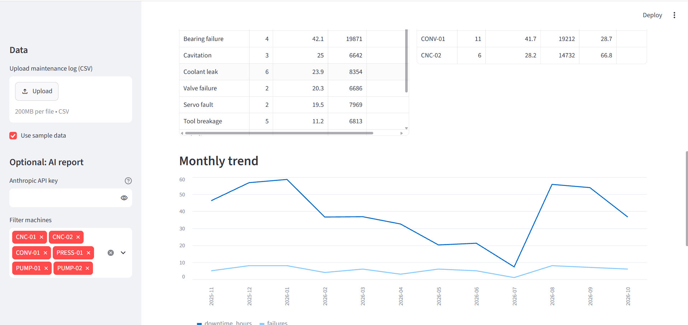
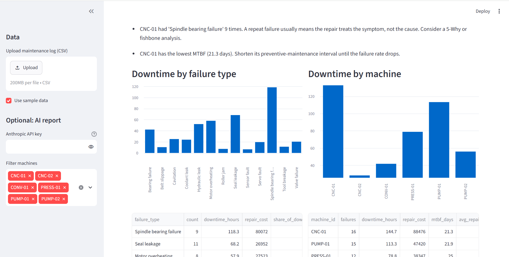

# 🔧 Maintenance Log Analyzer

[](https://maintenance-log-analyzer.streamlit.app/)

> **Live Demo:** [maintenance-log-analyzer.streamlit.app](https://maintenance-log-analyzer.streamlit.app/)

A small web app that turns a raw machine breakdown log into decisions: what fails most, which machines cost the most downtime, which failures keep repeating, and where to act first.

Built for maintenance and reliability teams who keep their logs in Excel or CSV and have no time to dig through them by hand.

## The problem

Factories record every breakdown, but the data usually sits unused. Maintenance managers end up guessing which machine or failure type deserves attention. This tool answers that in seconds.

## What it does

- Loads a maintenance log (CSV) and validates it
- Shows headline numbers: total failures, downtime hours, repair cost, average downtime per failure
- Ranks **failure types** and **machines** by downtime
- Calculates **MTBF** (mean time between failures) per machine
- Flags **repeat failures**, the best candidates for a root-cause fix (5-Why or fishbone)
- Plots the **monthly trend** of failures and downtime
- Gives plain-language **recommendations** with no API key needed
- Optional: generates an **AI-written reliability report** from the summary tables, downloadable as Markdown or HTML (bring your own key: Anthropic, OpenAI, Google Gemini, or any OpenAI-compatible service)

## Screenshots




## Run it locally

```bash
git clone <your-repo-url>
cd maintenance-log-analyzer
pip install -r requirements.txt
streamlit run app.py
```

The app opens in your browser with sample data selected, so you can explore it right away.

## Use your own data

Upload a CSV with these columns:

| Column | Meaning |
|---|---|
| `date` | Date of the breakdown (YYYY-MM-DD) |
| `machine_id` | Machine name or code, e.g. `CNC-01` |
| `failure_type` | Cause or category of the failure |
| `downtime_hours` | Hours the machine was down |
| `repair_cost` | Cost of the repair |
| `technician` | _(optional)_ Who did the repair |

`sample_data.csv` is fake data generated by `make_sample.py` for demo purposes.

## How it works

- `analyzer.py` holds all the analysis logic (pandas): loading, validation, ranking, MTBF, repeat-failure detection and recommendations.
- `app.py` is the Streamlit interface on top of it.
- `ai_report.py` sends the optional AI report request to the provider you choose (Anthropic, OpenAI or any OpenAI-compatible service, Google Gemini) using plain HTTP calls.
- The AI report sends only **aggregated tables**, never your raw log rows. The app asks the provider which models your key can use and picks a recent, fast one automatically (you can choose another from the list). This avoids hard-coded model names, which providers retire often.

## Key metric: MTBF

MTBF is the average number of days between consecutive failures of a machine. A low MTBF means the machine fails often, so its preventive-maintenance interval is probably too long.

## Ideas for next steps

- Add a failure-prediction model (for example survival analysis on time between failures)
- Add cost-of-downtime estimates using production value per hour
- Export the report as PDF
- Deploy on Streamlit Community Cloud for a live demo link

## Tech stack

Python, pandas, Streamlit, requests; optional LLM providers (Anthropic, OpenAI-compatible, Gemini)
